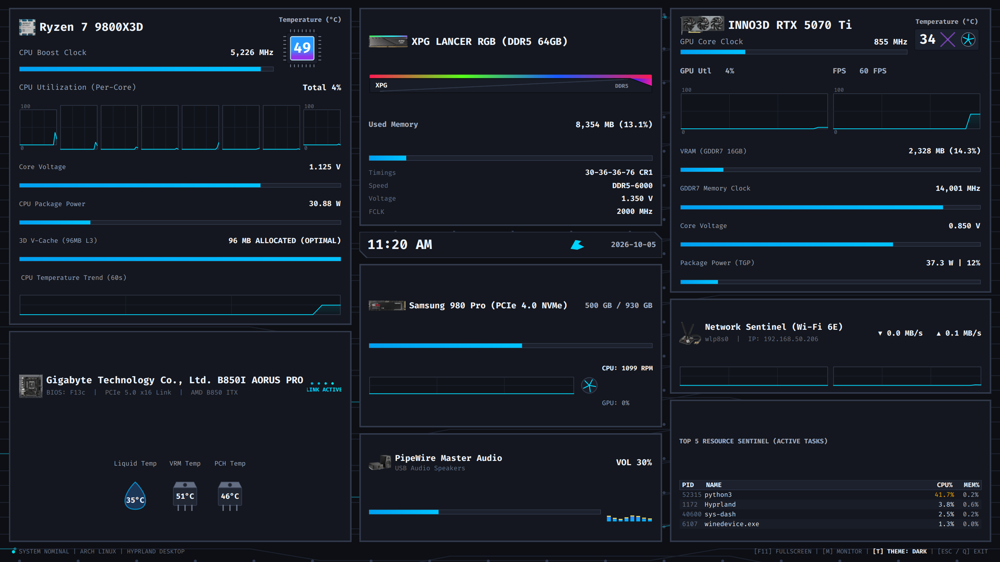

# Sys_Dash: AIDA64 화이트 & 다크 PCB 회로 기판 스타일 하드웨어 센서 패널



**Sys_Dash**는 게이밍, 3D 렌더링, 컴파일 등 고부하 작업 중 서브 모니터(예: ARZOPA 2K 144Hz, 울트라와이드 모니터 등)에 전체화면으로 시스템의 세부 센서 및 텔레메트리를 실시간 모니터링하기 위한 고성능 네이티브 데스크톱 AIDA64 스타일 센서 패널입니다.

살아 숨쉬는 **PCB 회로 전류 펄스 애니메이션**, **XPG 오로라 RGB 무지개 웨이브**, **8밴드 점핑 VU 이퀄라이저**, **3대 모니터 실시간 FPS 센티넬 바**, **멀티 오실로스코프 그래프**를 탑재하였으며, 런타임에 다크/화이트 모드를 즉시 상호 전환할 수 있습니다.

---

## ✨ 주요 특징 (Key Features)

1. **지능형 하이브리드 하드웨어 자동 감지 (`HardwareDetector`)**:
   - 어떤 PC(인텔/AMD CPU, 다양한 그래픽카드, 메인보드, RAM, NVMe SSD, 오디오 싱크 등)에서 실행하더라도 시스템 커널(`procfs`, `sysfs`), `DMI`, `NVML`, `psutil`, `PipeWire`를 통해 하드웨어 스펙을 **100% 자동 인식**합니다.
   - 4코어, 6코어, 8코어, 12코어, 16코어 등 **CPU 물리 코어 수에 맞춰 오실로스코프 그래프가 동적으로 생성**됩니다.
2. **간편한 하드웨어 커스텀 오버라이드 (`config.py`)**:
   - 튜닝 램 브랜드명, 타이밍 스펙, 공유기 모델명 등 감성 영역은 `config.py`의 `HardwareConfig`에서 단 한 줄로 자유롭게 커스텀할 수 있습니다.
3. **화이트 & 다크 듀얼 테마 (`ThemeManager`)**:
   - 매트 옵시디언 블랙(Dark)과 퓨어 세라믹 화이트(Light) 테마를 단축키 `T` 또는 화면 하단 클릭으로 1초 만에 즉시 전환할 수 있습니다.
4. **실시간 멀티 모니터 FPS 센티넬 (`TripleMonitorFpsWidget`)**:
   - `Hyprland IPC (JSON Socket)` 연동을 통해 멀티 모니터별 활성 창 및 Wayland `idle_inhibit` 프로토콜 기반으로 **게임(75~144 FPS)**, **유튜브/미디어(60 FPS)**, **데스크톱 작업**을 자동 판별하여 실황 FPS를 기록합니다.
5. **초저지연 비동기 센서 수집 엔진**:
   - `SystemMonitorCollector (QThread)` 백그라운드 스레드에서 NVML C 바인딩, 커널 RAPL 에너지 미분 연산, ISA `it8686` 칩셋, k10temp 물리 다이 온도(`Tccd1`)를 0%에 가까운 CPU 오버헤드로 수집하여 UI 렌더링 프레임 드랍을 원천 차단합니다.
6. **단일 독립 실행 바이너리 배포 지원**:
   - 파이썬이나 별도 라이브러리 설치 없이 실행할 수 있는 약 80MB 단일 ELF 독립 실행 파일(`dist/sys-dash`) 원클릭 빌드 지원.

---

## 🖥️ 3단 독립 분할 HUD 레이아웃

```
┌──────────────────────────────────┬──────────────────────────────────┬──────────────────────────────────┐
│     [좌측: 프로세서 & 기판]      │    [중앙: 메모리 / 스토리지 / 오디오]   │   [우측: 그래픽 & 네트워크 센티넬]   │
├──────────────────────────────────┼──────────────────────────────────┼──────────────────────────────────┤
│ 1. CPU 전용 독립 패널             │ 1. RAM RGB 메모리 패널           │ 1. GPU 전용 독립 패널            │
│    - CPU 부스트 클럭 프로그레스 바 │    - 풀컬러 RGB 오로라 웨이브     │    - 실시간 코어 클럭 & VRAM 바   │
│    - 실시간 물리 코어 다이 온도 배지 │    - 세부 타이밍 스펙 & 사용량    │    - 3대 모니터 실시간 FPS 센티넬  │
│    - 코어별 독립 미니 오실로스코프 │ 2. 사선 챔퍼 디지털 시계 바       │    - GPU 로드 & FPS 오실로스코프  │
│    - Vcore 전압 / Package Power  │ 3. NVMe SSD & 쿨링 팬 패널       │ 2. 네트워크 센티넬 패널          │
│ 2. 메인보드 전용 독립 패널        │    - 실시간 I/O 활동 오실로스코프 │    - 공유기 명칭 & IP / 대역폭    │
│    - DMI 기반 메인보드 & BIOS    │    - CPU / GPU 팬 회전 애니메이션 │    - 다운로드 & 업로드 듀얼 스코프 │
│    - PCIe 데이터 링크 펄스 애니   │ 4. PipeWire 사운드 패널          │ 3. 프로세스 센티넬 패널          │
│    - 수온 / VRM 전원부 / PCH 온도 │    - 대형 VOL 수치 + 볼륨 바      │    - TOP 5 점유 프로세스 테이블   │
│                                  │    - 8밴드 점핑 VU 이퀄라이저     │                                  │
└──────────────────────────────────┴──────────────────────────────────┴──────────────────────────────────┘
```

---

## ⚙️ 다른 시스템에 맞게 부품 수정하는 방법 (Customization Guide)

Sys_Dash는 **하이브리드(Hybrid) 모드**로 작동합니다. 즉, 아무것도 수정하지 않아도 시스템 하드웨어가 자동으로 화면에 반영되며, 특정 명칭이나 스펙을 직접 지정하고 싶을 때는 `config.py` 파일만 열어 수정하시면 됩니다.

### `config.py` 설정 가이드

```python
class HardwareConfig:
    # -------------------------------------------------------------------------
    # [1. 프로세서 (CPU)]
    # -------------------------------------------------------------------------
    # None: 시스템 커널(/proc/cpuinfo)에서 자동 인식 (예: "AMD Ryzen 7 9800X3D", "Intel Core i7-14700K")
    CPU_MODEL = None
    # None: CPU 최대 클럭 자동 감지 (MHz 단위, 예: 5500.0)
    CPU_MAX_CLOCK_MHZ = None
    # None: 설계 전력 자동 추정 (W 단위, 예: 140.0)
    CPU_TDP_W = None
    # None: L3 캐시 용량 자동 인식 (예: "3D V-Cache (96MB L3)", "L3 Cache (32MB)")
    CPU_CACHE_LABEL = None

    # -------------------------------------------------------------------------
    # [2. 그래픽카드 (GPU)]
    # -------------------------------------------------------------------------
    # None: NVML에서 GPU 모델명 자동 감지 (예: "INNO3D RTX 5070 Ti", "RTX 4080 SUPER")
    GPU_MODEL = None
    # None: GPU 최대 부스트 클럭 자동 지정
    GPU_MAX_CLOCK_MHZ = None
    # None: TGP 전력 한도 자동 감지 (예: 300.0)
    GPU_TGP_W = None
    # None: VRAM 실제 용량 기반 자동 표기 (예: "VRAM (GDDR7 16GB)")
    GPU_VRAM_LABEL = None

    # -------------------------------------------------------------------------
    # [3. 시스템 메모리 (RAM)]
    # -------------------------------------------------------------------------
    # 램 브랜드/모델명 표기 (총 용량은 시스템 실측치로 자동 결합됨)
    RAM_MODEL = "ADATA XPG LANCER RGB"
    # 램 타이밍 및 세부 스펙 라벨
    RAM_SPEC = "DDR5-6000  |  30-36-36-76  |  1.35V"

    # -------------------------------------------------------------------------
    # [4. 메인보드 (Motherboard)]
    # -------------------------------------------------------------------------
    # None: DMI에서 메인보드명 자동 감지 (예: "GIGABYTE B850I AORUS PRO")
    MOBO_NAME = None
    # None: BIOS 버전 및 PCIe 버스 상태 자동 포맷팅
    MOBO_SUB = None

    # -------------------------------------------------------------------------
    # [5. NVMe SSD 스토리지]
    # -------------------------------------------------------------------------
    # None: /sys/block/nvme*/device/model 에서 실제 장착된 SSD 모델명 자동 감지
    SSD_MODEL = None
    # SSD 인터페이스 및 읽기 속도 스펙 표기
    SSD_SPEC = "PCIe Gen4 x4  |  7,000 MB/s"

    # -------------------------------------------------------------------------
    # [6. 네트워크 게이트웨이 / 공유기]
    # -------------------------------------------------------------------------
    # 공유기 또는 라우터 명칭
    ROUTER_MODEL = "ASUS ROG GT-AX11000"

    # -------------------------------------------------------------------------
    # [7. 오디오 시스템]
    # -------------------------------------------------------------------------
    AUDIO_ENGINE = "PipeWire Master Audio"
    # None: 현재 기본 출력 오디오 장치명 자동 감지 (예: "USB Audio Speakers")
    AUDIO_DEVICE = None
```

---

## 🚀 빠른 시작 (Quick Start)

### 1. 단일 바이너리로 바로 실행 (추천)

컴파일된 단일 바이너리가 포함되어 있으므로, 클론 후 즉시 실행할 수 있습니다:

```bash
# 실행 권한 부여 후 실행
chmod +x ./sys-dash
./sys-dash
```

또는 편의 래퍼 스크립트를 사용할 수 있습니다:
```bash
./run_dashboard.sh
```

---

### 2. Python 가상환경에서 소스 코드로 실행

```bash
# 1. 저장소 클론
git clone https://github.com/kimjiho680629/Sys_Dash.git
cd Sys_Dash

# 2. 가상환경 생성 및 활성화
python3 -m venv .venv
source .venv/bin/activate

# 3. 필수 의존성 패키지 설치
pip install -r requirements.txt

# 4. 대시보드 실행
python3 main.py
```

---

### 3. 단일 독립 실행 바이너리 재빌드 (Build Executable)

코드나 에셋, 설정을 수정한 후 새 바이너리를 생성하려면 빌드 스크립트를 실행합니다:

```bash
./build_executable.sh
```
*빌드가 완료되면 `dist/sys-dash` 파일이 새롭게 생성됩니다.*

---

## ⌨️ 단축키 안내 (Keybindings)

| 단축키 | 동작 |
| :---: | :--- |
| **`T`** | 다크 모드 ⟷ 화이트 모드 즉시 전환 (하단 푸터 텍스트 클릭으로도 가능) |
| **`F11`** | 전체화면(FullScreen) 토글 |
| **`M`** | 모니터 전환 (`HDMI-A-1` ⟷ 주 모니터 간 윈도우 이동) |
| **`ESC` / `Q`** | 대시보드 종료 |

---

## 🪟 Hyprland 윈도우 매니저 연동 팁

Hyprland 환경에서 보조 모니터(`HDMI-A-1`)의 전용 워크스페이스(예: 9번)에 전체화면으로 자동 배치하고 단축키로 토글하려면 `~/.config/hypr/hyprland.conf`에 다음 규칙을 추가하세요:

```ini
# 1. Sys_Dash 윈도우 고정 규칙 (HDMI-A-1 보조 모니터 9번 워크스페이스 전체화면)
windowrulev2 = monitor HDMI-A-1, class:^(sys-dash)$
windowrulev2 = workspace 9, class:^(sys-dash)$
windowrulev2 = fullscreen, class:^(sys-dash)$

# 2. 단일 바이너리 원클릭 호출 단축키 (예: Super + F12)
bind = $mainMod, F12, exec, /home/kjh/Projects/Gemini_Job/Sys_Dash/dist/sys-dash
```

---

## 📁 디렉토리 구조

```
Sys_Dash/
├── assets/                     # 7대 하드웨어 실물 투명 누끼 PNG 사진 에셋
│   ├── cpu_photo.png           # CPU 정면 실물 칩셋 (34x34)
│   ├── gpu_photo.png           # GPU 실물 그래픽카드 (92x38)
│   ├── ram_photo.png           # DDR5 실물 램 스틱 (80x24)
│   ├── ssd_photo.png           # NVMe M.2 실물 스틱 (75x21)
│   ├── mobo_photo.png          # ITX 메인보드 실물 (48x48)
│   ├── audio_photo.png         # 하이엔드 오디오 스피커 실물 (46x46)
│   └── net_photo.png           # 게이밍 공유기 실물 (48x48)
├── dist/
│   └── sys-dash                # 컴파일된 단일 독립 실행 바이너리 (80MB)
├── sys-dash                    # dist/sys-dash를 가리키는 심볼릭 링크
├── build_executable.sh         # 원클릭 독립 실행 파일 빌드 스크립트
├── run_dashboard.sh            # 실행 래퍼 스크립트
├── requirements.txt            # 필수 파이썬 패키지 목록
├── main.py                     # 애플리케이션 진입점 및 3단 분할 윈도우 레이아웃
├── config.py                   # [사용자 설정] 디스플레이, 임계값 및 HardwareConfig
├── hardware_detector.py        # [신규] 시스템 하드웨어 커널/DMI/NVML 자동 감지 엔진
├── monitor_collector.py        # 센서 비동기 수집 백엔드 스레드 (NVML, psutil, PipeWire)
├── theme.py                    # 화이트/다크 테마 및 PCB 회로 전류 펄스 렌더러
├── widgets/                    # UI 컴포넌트 및 오실로스코프 그래프 모듈
├── dashboard_preview.png       # 대시보드 프리뷰 스크린샷 에셋
└── README.md                   # 본 문서
```

---

## 📜 라이선스 (License)

이 프로젝트는 오픈 소스로 제공되며, 개인 및 비상업적 용도로 자유롭게 사용, 수정, 배포할 수 있습니다.
